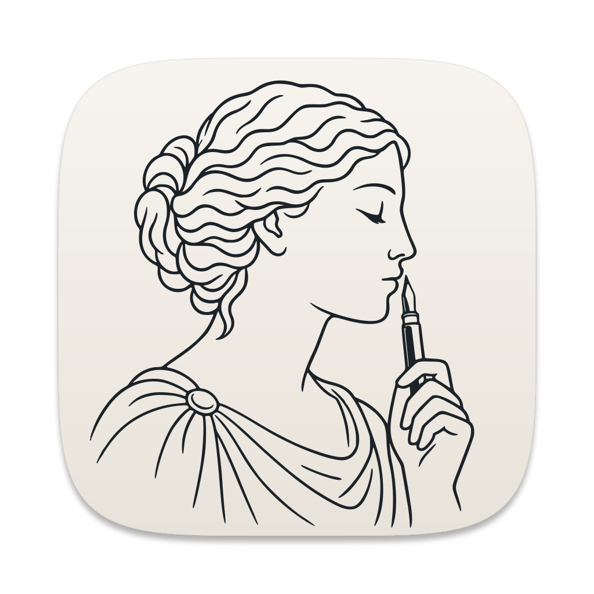
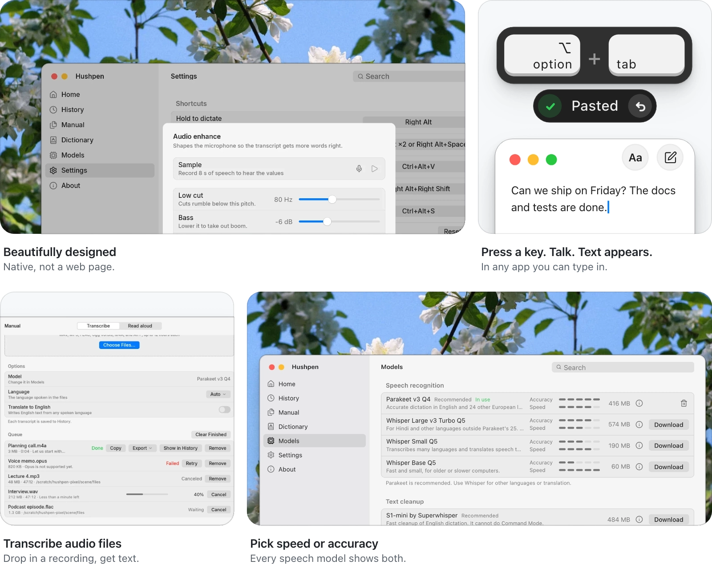

<p align="center">
  
</p>

<p align="center">
  <picture>
    <source media="(prefers-color-scheme: dark)" srcset="assets/readme/wordmark-dark.svg">
    
  </picture>
</p>

<p align="center">
  <b>Free dictation for Mac and Linux.</b><br>
  No subscription. No account. No word limit.
</p>

<p align="center">
  <a href="https://github.com/surajmandalcell/hushpen/releases/latest"><b>Download</b></a> &nbsp;·&nbsp;
  <a href="https://hushpen.mandalsuraj.com/">Website</a> &nbsp;·&nbsp;
  <a href="https://github.com/surajmandalcell/hushpen/issues">Report a problem</a>
</p>

<p align="center">
  <picture>
    <source type="image/avif" media="(prefers-color-scheme: dark)" srcset="assets/readme/cover-dark.avif">
    <source type="image/avif" media="(prefers-color-scheme: light)" srcset="assets/readme/cover-light.avif">
    <source media="(prefers-color-scheme: dark)" srcset="assets/readme/cover-dark.webp">
    
  </picture>
</p>

## Why Hushpen

Hushpen turns your voice into text, on your own computer.

- **Simple.** Press a key, talk, and press it again. The text is typed where your cursor is.
- **Private.** Nothing goes online. It keeps working with Wi-Fi off.
- **Clean.** "Um", repeats, and take-backs are removed.
- **Yours.** The code is open (AGPL-3.0). Add your own words. Pick any key.
- **Light.** A small native app, with no browser inside.

There is more: edit text by voice, read text aloud, drop in audio files, and search everything you said in History.

### How it compares

| | Hushpen | Wispr Flow | Aqua Voice | Superwhisper | VoiceInk |
| --- | :---: | :---: | :---: | :---: | :---: |
| Fully free | <picture><source media="(prefers-color-scheme: dark)" srcset="assets/readme/tick-dark.svg"></picture> | ✗ | ✗ | ◐ | ◐ |
| No account | <picture><source media="(prefers-color-scheme: dark)" srcset="assets/readme/tick-dark.svg"></picture> | ✗ | ✗ | ? | ? |
| Works offline | <picture><source media="(prefers-color-scheme: dark)" srcset="assets/readme/tick-dark.svg"></picture> | ✗ | ? | ✓ | ✓ |
| Open source | <picture><source media="(prefers-color-scheme: dark)" srcset="assets/readme/tick-dark.svg"></picture> | ✗ | ✗ | ✗ | ✓ |
| Mac and Linux | <picture><source media="(prefers-color-scheme: dark)" srcset="assets/readme/tick-dark.svg"></picture> | ✗ | ? | ✗ | ? |
| Native app, no browser engine | <picture><source media="(prefers-color-scheme: dark)" srcset="assets/readme/tick-dark.svg"></picture> | ✗ | ✗ | ? | ✓ |
| Polished design | <picture><source media="(prefers-color-scheme: dark)" srcset="assets/readme/tick-dark.svg"></picture> |  |  | ◐ | ◐ |

<details>
<summary><b>How we compared</b></summary>

<br>

✓ yes · ✗ no · ◐ partly · ? not confirmed. We checked each app's own website and documentation on 7 Nov 2026.

- Fully free means no payment and no word limit.
- Polished design is our opinion, not a fact. We marked Superwhisper and VoiceInk ◐ and left Wispr Flow and Aqua Voice blank.
- Hushpen runs on Apple silicon Macs only.
- Superwhisper: the free plan has local Whisper only. We could not confirm what its Mac app is built with.
- VoiceInk: free only as a source build. The signed app is paid after a trial. It is a native Swift app.
- Wispr Flow and Aqua Voice use Electron in the Mac builds we checked ([Wispr Flow](https://www.wensenwu.com/thoughts/wispr-flow-investigation), [Aqua Voice](https://github.com/dan-dr/aquarium/blob/main/docs/AQUA-PROTOCOLS.md)).

Sources: [Wispr Flow](https://wisprflow.ai/pricing), [Aqua Voice](https://aquavoice.com/pricing), [Superwhisper](https://superwhisper.com/docs/billing/plans), [VoiceInk](https://github.com/Beingpax/VoiceInk).

</details>

## Get started

<details open>
<summary><b>Mac</b> (Apple silicon, macOS 13 or later)</summary>

<br>

Run this in Terminal:

```sh
curl -fsSL https://hushpen.mandalsuraj.com/install.sh | sh
```

Or [download the `.dmg`](https://github.com/surajmandalcell/hushpen/releases/latest), open it, and drag **Hushpen** to **Applications**.

Then open Hushpen and:

1. Press **Allow** for **Microphone** and **Accessibility**. Allow **Input Monitoring** too if it is off.
2. Press **Download**. Hushpen starts with Parakeet v3 (416 MB, one time). You can switch to any other model in **Models**.
3. Click in any app where you can type. Press **Option + Tab**, say something, and press **Option + Tab** again to stop.

You can also hold **Right Option** while you talk, and let go to stop.

</details>

<details>
<summary><b>Linux</b> (x64 or arm64, X11)</summary>

<br>

Run this in a terminal:

```sh
curl -fsSL https://hushpen.mandalsuraj.com/install.sh | sh
```

Or download a file from the [latest release](https://github.com/surajmandalcell/hushpen/releases/latest). Use `arm64` instead of `x64` on an Arm machine.

| Your system | Command |
| --- | --- |
| Any | `chmod +x Hushpen-*-linux-x64.AppImage`, then run it |
| Debian and Ubuntu | `sudo apt install ./Hushpen-*-linux-x64.deb` |
| Fedora and openSUSE | `sudo dnf install ./Hushpen-*-linux-x64.rpm` |

Then open Hushpen and press **Download**. Hushpen starts with Parakeet v3 (416 MB, one time), and you can switch to any other model in **Models**. Click in any app, double tap **Right Alt** (or press **Right Alt + Space**), talk, and press **Right Alt** again to stop. You can also hold **Right Alt** while you talk, and let go to stop.

> [!NOTE]
> On Wayland, the key and the paste do not work. Use an X11 session.

</details>

## Learn more

<details>
<summary><b>Speech models</b></summary>

<br>

Hushpen starts with Parakeet v3 Q4. You can switch to any other model in the **Models** view.

| Model | Size | Good for |
| --- | --- | --- |
| Parakeet v3 Q4 | 416 MB | English and 24 other European languages. Hushpen starts with this one. |
| Whisper Large v3 Turbo Q5 | 574 MB | Hindi and other languages Parakeet does not know. |
| Whisper Small Q5 | 190 MB | Translating speech to English. |
| Whisper Base Q5 | 60 MB | Older or slower computers. |

Models download only when you ask.

</details>

<details>
<summary><b>The permissions do not work</b></summary>

<br>

macOS can forget a permission. Open **System Settings > Privacy & Security**, remove Hushpen from the list, and press **Allow** in Hushpen again. If a row stays stuck, run this in Terminal and press **Allow** again:

```sh
tccutil reset Microphone io.github.surajmandalcell.hushpen
tccutil reset ListenEvent io.github.surajmandalcell.hushpen
tccutil reset Accessibility io.github.surajmandalcell.hushpen
```

</details>

<details>
<summary><b>Build it yourself</b></summary>

<br>

You need [Rust](https://rustup.rs), CMake, and a C and C++ compiler. Then run:

```sh
git clone https://github.com/surajmandalcell/hushpen.git
cd hushpen
cargo build --release --locked -p hushpen-app -p hushpen-engine -p hushpen-llm -p hushpen-tts
```

The first build takes several minutes. See [docs/building.md](docs/building.md) for the full steps, the Linux packages, and the tests.

</details>

<br>

<p align="center">
  Open source apps can look this good. If you agree, a star on GitHub helps more people find Hushpen.<br>
  <a href="https://github.com/surajmandalcell/hushpen"><b>⭐ Star Hushpen on GitHub</b></a>
</p>

## License

Free software under the [AGPL-3.0-or-later](LICENSE).
